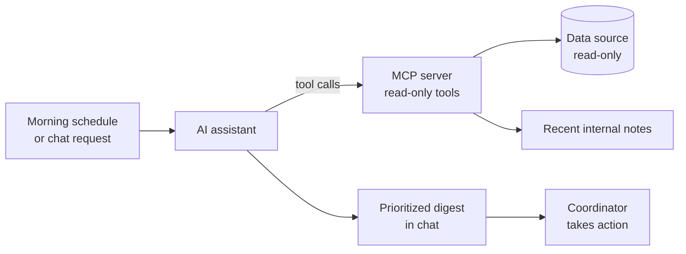
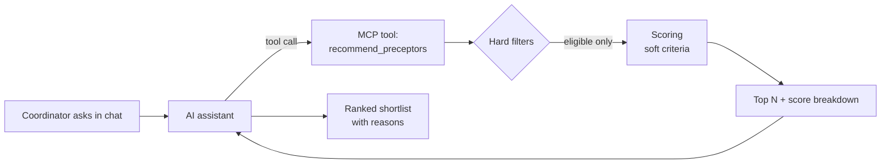

# Case Studies: AI-Assisted Features I Proposed and Validated

Real problems from my work as a QA Engineer on a healthcare clinical-placement platform, written up to show **how I think**: spotting workflow pain points, proposing AI-assisted solutions, and making them trustworthy through QA.

| # | Case study | What it shows |
|---|---|---|
| 1 | [AI Morning Action Digest](#case-study-1-ai-morning-action-digest) | Product idea, MCP-based AI design, SQL/business-rule validation, edge-case analysis |
| 2 | [AI Preceptor Recommender](#case-study-2-ai-preceptor-recommender) | Matching rules, ranking tests, golden datasets, testing AI explanations against data |

> **Confidentiality:** these case studies describe **my ideas and my QA approach**, not the company's system. Product, client and team names are removed. Schemas, queries, statuses and rules are rewritten and simplified, and none of them are copied from the real system. All people, records and numbers are synthetic. Links in the examples are placeholders.

---

## Case Study 1: AI Morning Action Digest

> **Case study · AI-assisted workflow · QA validation of data logic**

### 💬 How it looks in chat

<!-- Optional: drag digest-chat-mock.png here in the GitHub editor to show the screenshot -->

> **Coordinator:** What needs my attention today?

> **Claude:** Here's your action list for **Mon, Oct 19**. 14 items across 5 areas, most urgent first.
>
> **🔴 Rotations needing a new preceptor (3)**
>
> | Student | Specialty | Starts | Note | |
> |---|---|---|---|---|
> | Jordan Avery | Family NP | Nov 2 | Preceptor declined yesterday | [Open ↗](#) |
> | Priya Nolan | Psych-Mental Health NP | Nov 9 | Declined. No backup on file | [Open ↗](#) |
> | Sam Delgado | Pediatric NP | Nov 16 | Declined, paid in full | [Open ↗](#) |
>
> - **🟠 Upcoming starts with missing paperwork (4)**: 2 start within 7 days · [View all ↗](#)
> - **🟡 Cancelled rotations to verify (2)** · [View all ↗](#)
> - **🔵 Documents to review (3)** · [View all ↗](#)
> - **⚪ Unanswered messages (2)** · [View all ↗](#)
>
> ℹ️ *Skipped 2 items that are waiting on students to approve a replacement preceptor. No action is needed from you.*
>
> Want me to open the details for the 3 rotations that need a new preceptor?

<sub>Illustrative mock-up. Synthetic data. Links are placeholders.</sub>

---

### TL;DR

| | |
|---|---|
| **Problem** | Coordinators checked many screens every morning to find what needed *their* action, and items waiting on someone else added noise. |
| **My idea** | An AI assistant that builds a prioritized **morning action list** in chat, connected to project data through an **MCP server**, with internal notes parsed so the list reflects the latest changes. |
| **My role** | Proposed the concept. Ran the analysis spike that defined and validated the query logic and prompt rules behind each action domain. |
| **QA focus** | Correctness of the business rules: every item in the digest must need coordinator action, and nothing that does may be missing. |

---

### 1. Context

The product is a healthcare clinical-placement platform. Nursing students (NP, APRN, RN) book clinical rotations with preceptors, and **placement coordinators** move each rotation through its lifecycle: request → matching → payment → paperwork → rotation start.

Each coordinator handles many rotations at once. The status of a rotation can change because of the student, the preceptor, the school or the coordinator.

### 2. Problem

- No single place answered *"What do I need to do today?"*
- Coordinators opened several filtered views and read notes one by one.
- Many items looked actionable but were waiting on another party, such as a student who still has to approve a replacement preceptor.
- Recent changes recorded only in free-text notes were easy to miss.

### 3. My idea

I proposed an **AI morning digest**:

1. A scheduled prompt runs each morning (or a coordinator asks for it in chat).
2. The AI assistant reads data **only through an MCP server** that exposes a small set of read-only, pre-approved tools.
3. The assistant groups results into **8 action domains**, ranks them by urgency and shows them as a short, scannable list.
4. **One click to act:** every item and every group has a link that opens the record or a filtered list directly in the app. *(The real links are not shown in this case study.)*
5. **Notes parsing:** the assistant also reads recent internal notes, so an item that a note already resolved (*"student confirmed by phone"*) is dropped or flagged instead of shown as open.



**Why MCP:** the AI never writes free-form SQL. It can only call named, reviewed tools (for example `get_rotations_needing_preceptor`), so the logic is versioned, testable and auditable.

### 4. Action domains (generalized)

| # | Domain | Needs coordinator action when… |
|---|---|---|
| 1 | Rotations needing a new preceptor | Preceptor declined, rotation is paid, no replacement assigned yet |
| 2 | Cancelled rotations to verify | Rotation cancelled and cancellation not yet verified |
| 3 | New requests to review | Student request submitted and not yet reviewed |
| 4 | Documents to review | Uploaded document waiting for coordinator review |
| 5 | Upcoming starts with missing paperwork | Start date within N days and required paperwork incomplete |
| 6 | Waitlist ready to place | Waitlisted student now has a matching preceptor available |
| 7 | Overdue preceptor confirmations | Preceptor has not responded within the agreed window |
| 8 | Unanswered messages | Inbound message older than 24 h without a reply |

### 5. QA contribution

The digest is only useful if coordinators can trust it, so I treated it as a **data-correctness problem**.

#### Core rule I defined
> The digest lists items where **the coordinator is the next actor**. Items waiting on a student, preceptor or school are excluded.

#### How I validated each domain

1. Wrote the business rule in plain language and confirmed it with the product owner.
2. Drafted the query against the schema and documented every assumption.
3. Picked sample records and cross-checked each one against the UI and its notes.
4. Compared counts with the coordinators' manual lists.
5. Logged domains that were **blocked** by unclear schema, and **escalated** ambiguous business rules instead of guessing.

#### Edge cases (examples)

| Scenario | Expected | Why it matters |
|---|---|---|
| Replacement preceptor added, awaiting student approval | **Exclude** | The coordinator already did their part, so including it causes duplicate work |
| Preceptor declined, rotation still paid, no preceptor | **Include** (domain 1) | The highest-impact miss if it is lost |
| Cancelled rotation, not verified | **Include** (domain 2) | Financial and compliance follow-up |
| Note newer than status says "resolved" | **Flag** as possibly resolved | Notes parsing must override stale status, not hide it silently |
| Same rotation matches two domains | Show once, under the most urgent domain | Avoids noise and double counting |
| Soft-deleted or test records | **Exclude** | Common source of false positives |
| Record changed late in the evening | Appears in next morning's run | Time-window boundary (timezone) test |
| No items in a domain | Domain is hidden or shows "nothing today" | Empty state must not look like an error |

#### Example query (fictional schema)

```sql
-- Domain 1: rotations that need a new preceptor (coordinator is next actor)
SELECT r.rotation_id, s.display_name, r.start_date
FROM rotations r
JOIN students s ON s.student_id = r.student_id
WHERE r.state = 'paid'
  AND r.preceptor_id IS NULL
  AND r.is_deleted = FALSE
  AND EXISTS (
        SELECT 1 FROM preceptor_responses pr
        WHERE pr.rotation_id = r.rotation_id
          AND pr.response = 'declined')
  AND r.state <> 'awaiting_student_approval'   -- waiting on student, not coordinator
ORDER BY r.start_date;
```

### 6. Outcome

- Defined the scope as **8 action domains** with one clear, testable "coordinator is next actor" rule.
- Delivered validated query logic and prompt rules, plus a documented list of blockers and escalations, so development could start with known risks.
- Replaced "check several screens" with **one ranked list** that the coordinator can ask follow-up questions about in plain language.

### 7. What I learned

- With AI features, most bugs are in the **data rules**, not the AI. Validating queries first made the AI output trustworthy.
- "Who acts next?" is a strong test oracle for workflow software.
- Restricting the AI to reviewed MCP tools makes an AI feature testable like any other API.

---

## Case Study 2: AI Preceptor Recommender

> **Case study · AI-assisted matching · QA of ranking rules and AI explanations**

### 💬 How it looks in chat

<!-- Optional: drag recommender-chat-mock.png here in the GitHub editor to show the screenshot -->

> **Coordinator:** Find the best preceptors for Alex Morgan, Family NP, Austin TX, Nov 2 – Dec 18.

> **Claude:** I found **6 eligible preceptors** (out of 41 in the area). Here are the top 3:
>
> | # | Preceptor | Setting | Distance | Match |
> |---|---|---|---|---|
> | 1 | Dr. Taylor Brooks, FNP-C | Family practice clinic | 8 mi | 94% |
> | 2 | Morgan Ellis, DNP | Urgent care | 14 mi | 88% |
> | 3 | Casey Rivera, FNP-BC | Community health center | 22 mi | 81% |
>
> **Why #1:** Available for all dates, has hosted 6 Family NP students with no cancellations, replies within a day on average.
>
> ℹ️ *Excluded 35: 18 had no availability for these dates, 9 were at capacity, 5 are not open for matching, 3 are licensed in another state.*
>
> Want me to draft the request to Dr. Brooks?

<sub>Illustrative mock-up. Synthetic data. Links are placeholders.</sub>

---

### TL;DR

| | |
|---|---|
| **Problem** | Finding the right preceptor for a student took manual searching across specialty, location, dates and availability. |
| **My idea** | Ask in chat: *"Who are the best preceptors for this student?"* The AI returns a ranked shortlist **with the reason for each match**, based only on approved data. |
| **My role** | Proposed the concept, defined the matching rules with the team, and designed the test approach for ranking and AI explanations. |
| **QA focus** | Hard rules are never broken (eligibility, visibility, capacity), ranking is consistent, and every AI explanation matches the actual data. |

---

### 1. Context

The product is a healthcare clinical-placement platform that matches nursing students (NP, APRN, RN) with preceptors for clinical rotations. A good match depends on many factors at once, and a wrong match costs time for the student, the preceptor and the coordinator.

### 2. Problem

- Coordinators combined several filters by hand and relied on memory ("this preceptor responds fast").
- Results were inconsistent between coordinators.
- There was no quick way to explain *why* a preceptor was suggested.

### 3. My idea

A recommender that works in two layers:

1. **Hard filters (deterministic, never decided by AI):** specialty, license/state, availability window, remaining capacity, and the preceptor being **open for matching**.
2. **Soft ranking:** distance, past match success, response time and student preferences, combined into a score.
3. **AI layer:** the assistant presents the top results in chat and explains each one in plain language, using **only the fields the tools returned**.



**Key design decision:** the AI ranks and explains, but it **cannot add** a preceptor that the hard filters removed.

### 4. QA contribution

#### Test strategy

| Layer | What I tested | How |
|---|---|---|
| Hard filters | Ineligible preceptors never appear | Synthetic dataset with one "trap" record per rule |
| Ranking | Same input → same order. Better match → higher rank | Golden dataset with an expected top 3 per student |
| AI explanation | Every stated reason is true for that preceptor | Compare each claim in the reply with the tool output |
| Empty / edge results | Clear message, no invented matches | Students with no eligible preceptor |

#### Edge cases (examples)

| Scenario | Expected |
|---|---|
| Preceptor not open for matching (hidden / non-public) | **Never** recommended, even if a perfect fit |
| Preceptor at full capacity for those dates | Excluded |
| Availability overlaps only part of the rotation | Excluded, or flagged as "partial" by rule. Never shown as a full match |
| License state differs from the rotation state | Excluded |
| Two preceptors with an equal score | Stable tie-break (for example, sooner availability) |
| No eligible preceptors | Explains which filter removed them, suggests the waitlist |
| AI says "5 miles away" but the data says 25 | **Bug**. The explanation must match the data |
| Availability changed after the last data refresh | Results show data freshness. Re-check before booking |

#### Example: golden test case (synthetic)

```yaml
student:
  name: Alex Morgan
  program: Family NP
  state: TX
  dates: 2026-11-02 → 2026-12-18
  preferred_radius_miles: 30
expected_top_3: [P-104, P-221, P-087]
must_not_include:
  - P-310   # not open for matching
  - P-155   # at capacity for these dates
  - P-402   # licensed in another state
```

### 5. Outcome

- Matching rules are written down as **testable hard filters and soft criteria** instead of living in people's heads.
- Coordinators get a **ranked shortlist with reasons** in seconds and can ask follow-up questions in chat.
- Visibility and eligibility rules got explicit regression tests, which also protects the existing manual matching flow.

### 6. What I learned

- For AI features, separate **what must be true** (deterministic rules) from **what can be ranked or explained** (AI). Test them differently.
- An explanation is a testable output. Every claim must trace back to a data field.
- Small synthetic "trap" datasets catch visibility and eligibility bugs faster than large random data.
