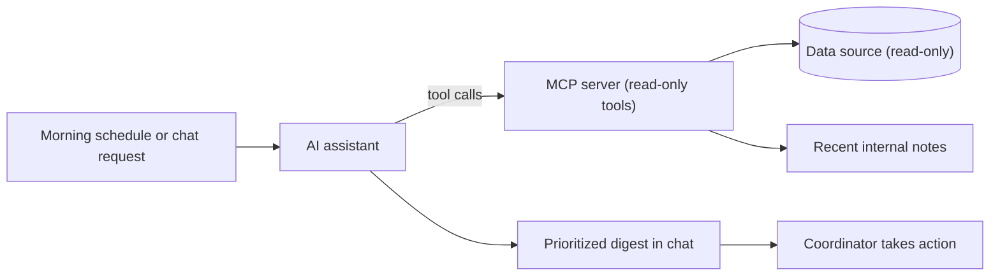
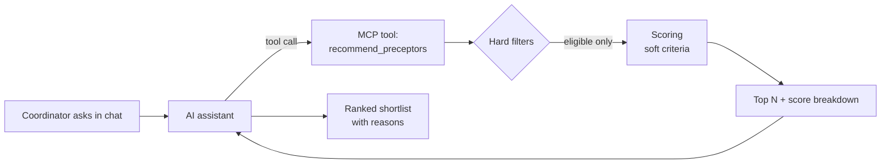

## From Problem to AI Solution

Here are examples of ideas I brought to the team. While testing, I kept seeing where people lost time in the app. I suggested ways to fix that using what was already there, without rebuilding anything. I helped shape the solutions, built the queries behind them and designed how they should work.

<table>
  </thead>
  <tbody>
    <tr>
      <td>1</td>
      <td><a href="#case-study-1-ai-morning-action-digest">AI Morning Action Digest</a></td>
      <td>Product idea, MCP-based AI design, SQL/business-rule validation, edge-case analysis</td>
    </tr>
    <tr>
      <td>2</td>
      <td><a href="#case-study-2-ai-preceptor-recommender">AI Preceptor Recommender</a></td>
      <td>Matching rules, ranking tests, golden datasets, testing AI explanations against data</td>
    </tr>
  </tbody>
</table>


## Case Study 1: AI Morning Action Digest

### 1. Context
The product is a healthcare clinical-placement platform. Nursing students (NP, APRN, RN) book clinical rotations with preceptors, and **placement coordinators** move each rotation through its lifecycle: request → matching → payment → paperwork → rotation start.

### 2. Problem
- Each coordinator handles many rotations at once. The status of a rotation can change because of the student, the preceptor, the school or the coordinator.
- Coordinators checked many screens every morning to find what needed action and items waiting on someone else's response- what has been changed since yesterday, what needs the coordinator's attention.
- Many items looked actionable but were waiting on another party, such as a student who still has to approve a replacement preceptor.
- Recent changes recorded only in free-text notes were easy to miss - communication outside the app.

### 3. My idea - AI morning digest

1. A scheduled prompt runs each morning (a coordinator runs a one-word prompt in a chat).
2. The AI assistant reads data **only through an MCP server** that exposes a small set of read-only, pre-approved tools.
3. The assistant groups results into **8 action domains**, ranks them by urgency and shows them as a short, scannable list.
4. **One click to act:** every item and every group has a link that opens the record or a filtered list directly in the app.
5. **Notes parsing:** The assistant also reads recent internal notes to keep track of the recent recorded actions (*"student confirmed by phone"*).

   
   



### 4. How it looks in a chat


### 5. QA contribution

1. Proposed the concept.
2. Wrote the business rule in plain language and confirmed it with the product owner.
3. Ran the analysis spike that defined and validated the query logic and prompt rules.
4. Drafted the query against the schema and documented every assumption.
5. Picked sample records and cross-checked each one against the UI and its notes.
6. Compared counts with the coordinators' manual lists from the app.

#### Example query (fictional schema)

```sql
-- Domain 1: rotations that need a new preceptor (coordinator is next actor)
SELECT r.rotation_id, s.display_name, r.start_date
FROM rotations r
JOIN students s ON s.student_id = r.student_id
WHERE r.state = 'paid'
  AND r.preceptor_id IS NULL
  AND r.is_deleted = FALSE
  AND EXISTS (
        SELECT 1 FROM preceptor_responses pr
        WHERE pr.rotation_id = r.rotation_id
          AND pr.response = 'declined')
  AND r.state <> 'awaiting_student_approval'   
ORDER BY r.start_date;
```


## Case Study 2: AI Preceptor Recommender
### 1. Context

The product is a healthcare clinical-placement platform that matches nursing students (NP, APRN, RN) with preceptors for clinical rotations. A good match depends on many factors at once, and a wrong match costs money and time for the student, the preceptor and the coordinator.

### 2. Problem

- Coordinators combined several filters by hand to check a preceptor's availability.
- Finding the right preceptor for a student took manual searching across speciality, status, location, dates and finances - one overlooked criterion is enough to make the match fail.
- Easy to make a mistake.
  
### 3. My idea
Paste a rotation ID to get a ranked shortlist of the best preceptors, or add a preceptor ID to check how well that one fits. Every result comes with the reason for the match.
A recommender that works in two layers:

1. **Hard filters (deterministic, never decided by AI):** specialty, license/state, availability window, remaining capacity, and the preceptor being **open for matching**.
2. **Soft ranking:** distance, past match success, response time and student preferences, combined into a score.
3. **AI layer:** the assistant presents the top results in chat and explains each one in plain language, using **only the fields the tools returned**.




### 4. How it looks in a chat


### 5. QA contribution

1. Proposed the concept.
2. Listed the matching rules with the team and split them into required checks and fit factors.
3. Wrote each rule in plain language and confirmed it with the product owner.
4. Defined the matching rules with the team and designed the test approach for ranking and AI explanations.
5. Built test data with one "trap" preceptor per rule (wrong state, no free spots, closed for matching, wrong dates) to make sure none of them ever appeared.
6. Prepared a set of test rotations, each with an expected top 3, to check that the ranking stayed stable.
7. Checked that a single match check for one preceptor gave the same score and position as the shortlist.
8. Compared every reason in the AI's reply with the data it returned, to catch wrong distances, invented experience or missing warnings.
9. Tested rotations with no eligible preceptors to make sure the reply explained why, instead of inventing matches.

##  What I learned
- For AI features, separate what must be true (deterministic rules) from what can be ranked or explained. Test them differently.
- An explanation is a testable output. Every claim must trace back to a data field.
- Small synthetic "trap" datasets catch visibility and eligibility bugs faster than large random data.


