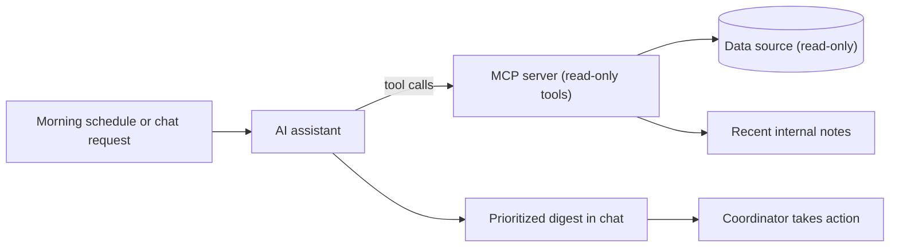
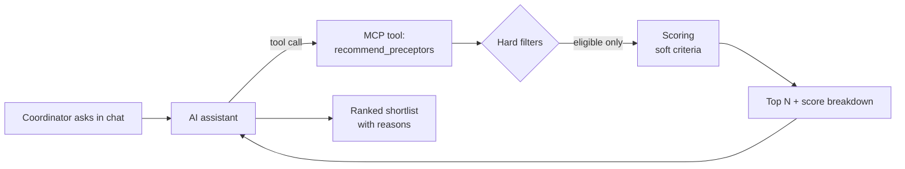

## From Problem to AI Solution

Here are examples of ideas I brought to the team. While testing, I kept seeing where people lost time in the app. I suggested ways to fix that using what was already there, without rebuilding anything. I helped shape the solutions, built the queries behind them and designed how they should work.

<table>
  </thead>
  <tbody>
    <tr>
      <td>1</td>
      <td><a href="#case-study-1-ai-morning-action-digest">AI Morning Action Digest</a></td>
      <td>Product idea, MCP-based AI design, SQL/business-rule validation, edge-case analysis</td>
    </tr>
    <tr>
      <td>2</td>
      <td><a href="#case-study-2-ai-preceptor-recommender">AI Preceptor Recommender</a></td>
      <td>Matching rules, ranking tests, datasets, testing AI explanations against data</td>
    </tr>
  </tbody>
</table>


## Case Study 1: AI Morning Action Digest

### 1. Context and problem
Nursing students book clinical rotations with preceptors on a healthcare placement platform. Placement coordinators move each rotation through its stages: request → matching → payment → paperwork → start.

- Every morning, coordinators checked many screens to find what had changed since yesterday and what needed their action.
- Many items looked actionable but were waiting on someone else, such as a student who still had to approve a replaced preceptor, a preceptor's approval, or school sign-up.
- Changes recorded only in free-text notes were easy to miss since most communication happened outside the app.

### 2. From Idea to Solution -  AI morning digest

1. A coordinator runs a one-word prompt in a chat each morning (it could also be scheduled). The assistant reads data only through an MCP server with a small set of read-only, pre-approved tools.
2. It groups results into 8 action domains, ranks them by urgency, and shows a short, scannable list. One click to act: every item and group links to the record or a filtered list in the app.
3. Notes parsing: it also reads recent internal notes, so actions recorded outside the app (e.g. student confirmed by phone) are not missed.

   



### 3. How it looks in a chat


### 4. QA contribution

1. Proposed the concept, wrote the business rule in plain language, and confirmed it with the product owner.
2. Ran the analysis spike that defined and validated the query logic and prompt rules, drafting the query against the schema and documenting every assumption.
3. Validated the output: cross-checked sample records against the UI and its notes, and compared counts with the coordinators’ manual lists.

#### Example query (fictional schema)

```sql
-- Domain 1: rotations that need a new preceptor (coordinator is next actor)
SELECT r.rotation_id, s.display_name, r.start_date
FROM rotations r
JOIN students s ON s.student_id = r.student_id
WHERE r.state = 'paid'
  AND r.preceptor_id IS NULL
  AND r.is_deleted = FALSE
  AND EXISTS (
        SELECT 1 FROM preceptor_responses pr
        WHERE pr.rotation_id = r.rotation_id
          AND pr.response = 'declined')
  AND r.state <> 'awaiting_student_approval'   
ORDER BY r.start_date;
```


## Case Study 2: AI Preceptor Recommender

### 1. Context and Problem
A healthcare placement platform matches nursing students with preceptors for clinical rotations. 

- A wrong match costs money and time for the student, the preceptor and the coordinator.
- Coordinators combined several filters by hand across speciality, status, location, dates and finances, and one overlooked criterion was enough to make a match fail.
  
### 2. From Idea to Solution
Paste a rotation ID to get a ranked shortlist of the best preceptors, or add a preceptor ID to see how well it fits. Every result comes with the reason for the match.
A recommender that works in two layers:

1. **Hard filters (deterministic, never decided by AI):** speciality, license/state, availability window, remaining capacity, and the preceptor being **open for matching**.
2. **Soft ranking:** distance, past match success, response time and student preferences, combined into a score.
3. **AI layer:** the assistant presents the top results in chat and explains each one in plain language, using **only the fields the tools returned**.




### 3. How it looks in a chat


### 4. QA contribution

1. Proposed the concept. Listed the matching rules with the team, split them into required checks and fit factors, wrote each in plain language, and confirmed them with the product owner.
2. Designed the test approach for ranking and AI explanations:
     - one “trap” preceptor per rule (wrong state, no free spots, closed for matching, wrong dates), to make sure none of them ever appeared
     - test rotations with an expected top 3, to check the ranking stayed stable and that a single match check gave the same score and position as the shortlist
3. Checked every reason in the AI’s reply against the data it returned, to catch wrong distances, invented experience or missing warnings. Tested rotations with no eligible preceptors, to make sure the reply explained why instead of inventing matches.

##  What I learned
- For AI features, separate what must be true (deterministic rules) from what can be ranked or explained. Test them differently.
- An explanation is a testable output. Every claim must trace back to a data field.
- Small synthetic "trap" datasets catch visibility and eligibility bugs faster than large random data.


