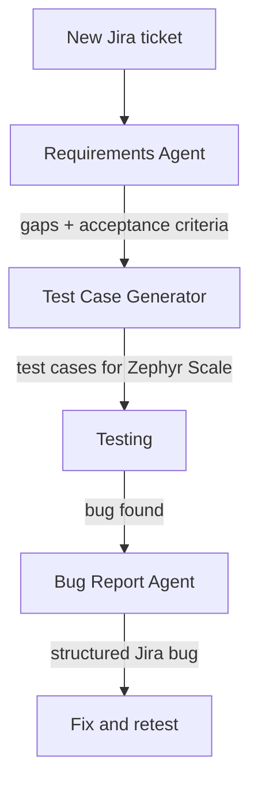

# AI Agents I Built for QA

Some parts of QA work repeat every day: reading new tickets, writing test cases, filing bugs. I built three Claude agents connected to Jira and Confluence through the Atlassian MCP, so that work takes minutes instead of hours. The agents follow the same rules and formats every time, and I stay in control: nothing goes into Jira until I've checked it.

<table>
  <thead>
    <tr>
      <th>#</th>
      <th>Agent</th>
      <th>What it does</th>
    </tr>
  </thead>
  <tbody>
    <tr>
      <td>1</td>
      <td><a href="#agent-1-qa-requirements-agent">QA Requirements Agent</a></td>
      <td>Finds gaps in a ticket before development starts and drafts testable acceptance criteria</td>
    </tr>
    <tr>
      <td>2</td>
      <td><a href="#agent-2-test-case-generator">Test Case Generator</a></td>
      <td>Turns a ticket into structured test cases, ready for Zephyr Scale</td>
    </tr>
    <tr>
      <td>3</td>
      <td><a href="#agent-3-bug-report-agent">Bug Report Agent</a></td>
      <td>Turns my quick notes into a complete Jira bug report</td>
    </tr>
  </tbody>
</table>

### How the agents fit together

Each agent covers one step of the ticket's life, from the first read to the bug report.

---

## Agent 1: QA Requirements Agent

### 1. Problem

- Tickets often reached development with missing details: which roles, which statuses, what happens to payments, who gets notified.
- These questions usually came up during testing, when fixing them was already expensive.

### 2. What it does

1. Reads a Jira ticket from start to finish.
2. Flags what's **missing**, **unclear** or **conflicting**, and explains why each gap matters.
3. Turns each gap into a question for the product owner.
4. Drafts acceptance criteria in a Given / When / Then format, and marks the ones that depend on an open question.

### 3. How I built it

1. Set it up as a shared Claude project, so the whole team uses the same agent and the same rules.
2. Wrote a checklist of what a complete ticket needs: roles and permissions, statuses, data and payment impact, notifications, error messages and edge cases.
3. Told the agent never to fill a gap with a guess. If something is missing, it asks.
4. Fixed the output format, so every review looks the same and is quick to read.

### 4. How it looks in chat

<!-- Drag requirements-agent-mock.png here -->

Illustrative mock-up. Synthetic data.

---

## Agent 2: Test Case Generator

### 1. Problem

- Writing test cases by hand for every ticket took a lot of time, and coverage depended on how busy I was that day.
- The cases then had to be reformatted before they could go into Zephyr Scale.

### 2. What it does

1. Reads a Jira ticket and generates structured test cases with steps and expected results.
2. Covers the happy path, data accuracy, boundaries, status changes, role access, export and negative cases.
3. Labels each case with the test design technique behind it.
4. Lists the assumptions to confirm before the cases are imported.

### 3. How I built it

1. Gave the agent the test design techniques I use: equivalence partitioning, boundary values, decision tables, state transitions and role-based access testing.
2. Defined a fixed set of coverage areas, so no ticket skips negative or access tests.
3. Matched the output to the Zephyr Scale import format.
4. Made it list assumptions instead of hiding them, so I can check them with the team first.

### 4. How it looks in chat

<!-- Drag test-case-generator-mock.png here -->

Illustrative mock-up. Synthetic data.

---

## Agent 3: Bug Report Agent

### 1. Problem

- While testing, I write bugs down as quick notes, with shorthand and typos.
- Turning each note into a full Jira ticket took time and pulled me out of testing.

### 2. What it does

1. Takes my short note and writes a full bug report: title, description, preconditions, steps, actual and expected results, environment.
2. Follows the team's title format: `[Module] Short description of the issue`.
3. Uses any technical evidence I give it (console errors, API responses) to suggest a likely cause.
4. Splits a note that describes more than one problem into separate tickets.
5. Lists its assumptions and creates the ticket in Jira only after I approve it.

### 3. How I built it

1. Defined the ticket structure, title format and default environment, so every report looks the same.
2. Connected the agent to Jira through the Atlassian MCP, so it can create tickets and add comments.
3. Added a review step: the agent shows the draft first and asks before creating anything.
4. Taught it to state its assumptions (role, environment, expected behavior) instead of guessing silently.

### 4. How it looks in chat

<!-- Drag bug-report-agent-mock.png here -->

Illustrative mock-up. Synthetic data.

---

## What I learned

- An agent is only as good as its rules. Most of my time went into deciding what "a complete ticket" or "a good bug report" means, not into the AI itself.
- The most useful thing an agent can say is "I don't know". Asking instead of guessing is what made the team trust the output.
- Keeping a person in the loop costs a few seconds and prevents most mistakes. Nothing reaches Jira without my review.
- Shared agents raise the level for the whole team. Everyone gets the same checks, not just the person who remembers them.

---

All ticket IDs, names and examples on this page are made up. Nothing is copied from the real system.
