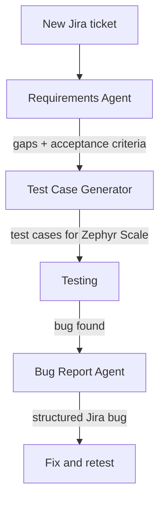

## AI Agents that handle the routine QA work

Here are the AI agents I built to take the repetitive work off my plate. They connect to Jira and Confluence through the Atlassian MCP, help me review tickets, write test cases and report bugs, and always leave the final check to me.

<table>
  <thead>
    <tr>
      <th>#</th>
      <th>Agent</th>
      <th>What it does</th>
    </tr>
  </thead>
  <tbody>
    <tr>
      <td>1</td>
      <td><a href="#agent-1-qa-requirements-agent">QA Requirements Agent</a></td>
      <td>Spots what’s missing in a ticket before development starts, and writes acceptance criteria you can test</td>
    </tr>
    <tr>
      <td>2</td>
      <td><a href="#agent-2-test-case-generator">Test Case Generator</a></td>
      <td>Turns a ticket into structured test cases, ready for Zephyr Scale</td>
    </tr>
    <tr>
      <td>3</td>
      <td><a href="#agent-3-bug-report-agent">Bug Report Agent</a></td>
      <td>Turns my quick one-line description into a complete Jira bug report</td>
    </tr>
  </tbody>
</table>

### How the agents fit together

## Agent 1: QA Requirements Agent

### 1. Problem

- Some tickets were created by the tech team based on their own investigation, so it wasn't always clear what had actually changed.
- Acceptance criteria were often missing.
- There was no information for testing: what to check, which roles or flows were affected, or what the expected behaviour was.
- Testing couldn't start until I tracked down the answers, which slowed down the whole release.

### 2. What it does

1. Reads a Jira ticket from start to finish.
2. Flags what's missing, unclear or conflicting, and explains why each gap matters.
3. Turns each gap into a question for the product owner and lists them in ticket notes.
4. Drafts acceptance criteria in a Given / When / Then format, and marks the ones that depend on an open question.

### 3. How I built it

1. Set it up as a shared Claude project, so the whole team uses the same agent and the same rules.
2. Wrote a checklist of what a complete ticket needs: What changed, scope, roles and permissions, statuses, data and system impact, acceptance criteria, and edge cases.
3. Told the agent never to fill a gap with a guess. If something is missing, it asks.
4. Fixed the output format, so every review looks the same and is quick to read.

### 4. How it looks in chat

## Agent 2: Test Case Generator

### 1. Problem

- Every new ticket needed a full set of test cases, and writing them by hand took a big part of each sprint.
- With tight deadlines, there was a risk of skipping less obvious checks, like role access, boundaries or negative cases.

### 2. What it does

1. Reads a Jira ticket and generates structured test cases with steps and expected results.
2. Covers the happy path, data accuracy, boundaries, status changes, role access, export and negative cases.
3. Labels each case with the test design technique behind it.
4. Shows coverage metrics: requirement coverage, traceability and the share of functional, negative and edge cases.

### 3. How I built it

1. Gave the agent the test design techniques I use: equivalence partitioning, boundary values, decision tables, state transitions and role-based access testing.
2. Defined a fixed set of coverage areas, so no ticket skips negative or access tests.
3. Required every test case to point to an acceptance criterion, so gaps in coverage show up right away.
4. Added a metrics summary to every result, so I can check coverage before importing anything.
5. Matched the output to the Zephyr Scale import format.

### 4. How it looks in chat

---

## Agent 3: Bug Report Agent

### 1. Problem

- While testing, I write bugs down as quick notes, with shorthand and typos.
- Turning each note into a full Jira ticket took time and pulled me out of testing.

### 2. What it does

1. Takes my short note and writes a full bug report: title, description, preconditions, steps, actual and expected results, environment.
2. Follows the team's title format: `[Module] Short description of the issue`.
3. Uses any technical evidence I give it (console errors, API responses) to suggest a likely cause.
4. Splits a note that describes more than one problem into separate tickets.
5. Lists its assumptions and creates the ticket in Jira only after I approve it.

### 3. How I built it

1. Defined the ticket structure, title format and default environment, so every report looks the same.
2. Connected the agent to Jira through the Atlassian MCP, so it can create tickets and add comments.
3. Added a review step: the agent shows the draft first and asks before creating anything.
4. Taught it to state its assumptions (role, environment, expected behavior) instead of guessing silently.

### 4. How it looks in chat

<!-- Drag bug-report-agent-mock.png here -->

Illustrative mock-up. Synthetic data.

---

## What I learned

- An agent is only as good as its rules. Most of my time went into deciding what "a complete ticket" or "a good bug report" means, not into the AI itself.
- The most useful thing an agent can say is "I don't know". Asking instead of guessing is what made the team trust the output.
- Keeping a person in the loop costs a few seconds and prevents most mistakes. Nothing reaches Jira without my review.
- Shared agents raise the level for the whole team. Everyone gets the same checks, not just the person who remembers them.

---

All ticket IDs, names and examples on this page are made up. Nothing is copied from the real system.
